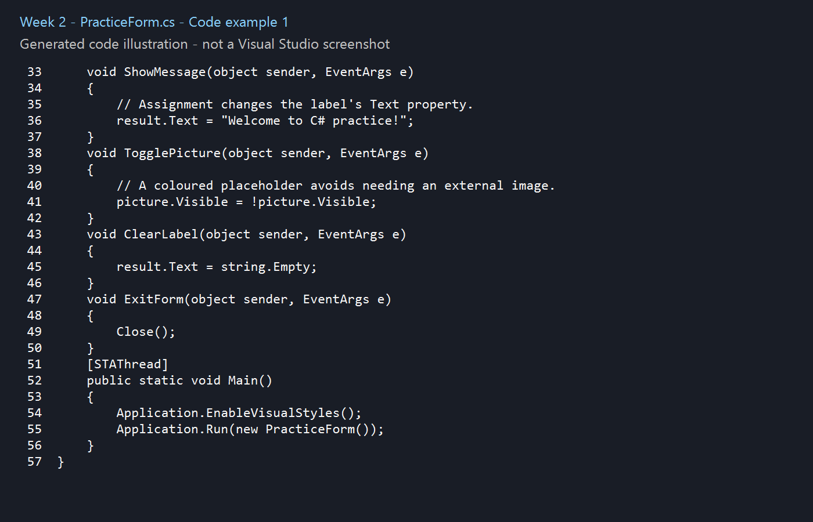
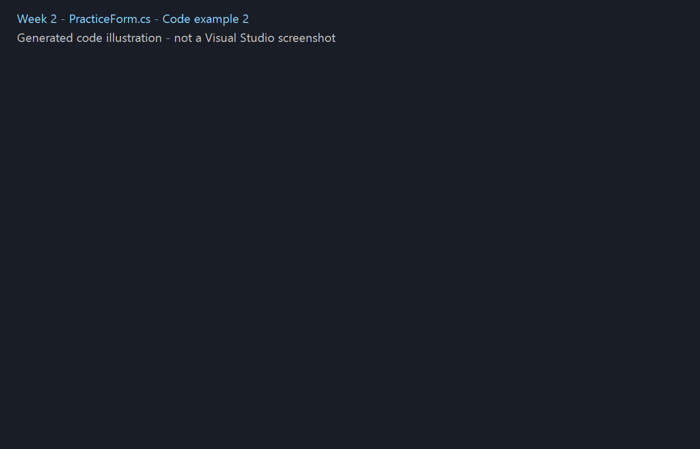

# Week 2 - Chapter 1 continuation: Forms and Events

This continues Week1, which already introduces objects, controls, the IDE, forms and a button message.

- An event handler runs when an event such as a button click occurs.
- Assigning a string to `Label.Text` changes displayed output. An empty string clears it.
- A PictureBox displays images. `Visible` controls its visibility and `SizeMode` controls image fitting. This exercise uses a coloured placeholder; set Image in the Designer to try a real picture.
- A namespace groups classes, a class describes an object, and methods contain executable statements. This small example uses the global namespace.
- Statements execute in sequence. Comments, blank lines and indentation make code easier to read.
- `Close()` closes the form. IntelliSense suggests members, while compiler errors point out invalid syntax.

## Practice
Run the form. Show changes the label, Toggle hides or shows the placeholder, Clear empties the label, and Exit closes the form.

Try changing the message and assigning an image to the PictureBox. Temporarily remove a semicolon, read the compiler error, then restore it.

## Run in Visual Studio
Open the .csproj in practice/ with Visual Studio on Windows. Install the .NET desktop development workload and .NET Framework 4.8 targeting pack if requested. Press F5. Controls are created in code, so this exercise does not use a Designer file.

## Code images
The screenshot/ folder contains generated code illustrations from the included source, labelled as such. They are study examples, not screenshots of a student's Visual Studio session. The examples and summaries were prepared with AI assistance for review and practice.

Source topics: the supplied Gaddis, Starting Out with Visual C#, sixth edition chapter slides. These notes and exercises use original wording and code.