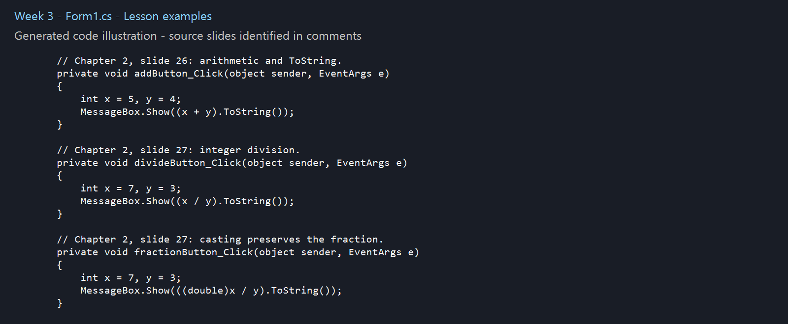
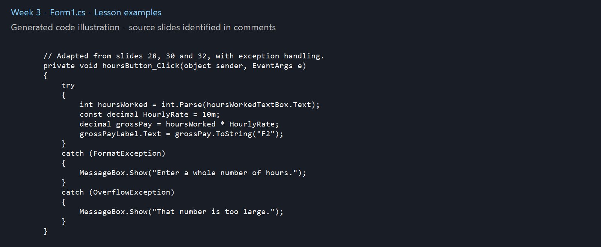

# Week 3 - Lesson Practice

## Concepts
Chapter 2: arithmetic, integer division, casting, Parse, numeric output, constants and exception handling.

## Chapter summary
- TextBox.Text contains a string, even when the user types digits.
- Variables have types: `string` for text, `int` for whole numbers, `decimal` for money and `double` for general floating-point calculations.
- Parse converts text to a number. FormatException and OverflowException handle invalid or excessively large input.
- Arithmetic operators include +, -, *, / and %. Parentheses control evaluation order. Integer division discards the fractional part.
- A named constant stores a value that cannot change. Local variables belong to a method; fields belong to the object and retain values between events.
- ToString("F2") displays two decimal places. Math.Round rounds a value; formatting changes its displayed representation.
- Breakpoints and stepping help inspect values and locate logic errors. TabIndex sets keyboard navigation order and Focus() selects a control for input.

## Examples from the lesson
The comments in [Form1.cs](practice/Form1.cs) identify the source chapter and slide for each example. Some short examples follow the supplied Gaddis Visual C# sixth edition slides directly; others adapt them with input controls, event handlers or error handling. Added practice code is marked. Slide numbers refer to positions in your supplied PowerPoint, whose section numbers sometimes differ from the chapter number.

## Visual Studio files
- Form1.cs contains the constructor and button Click handlers, in the style used in class.
- Form1.Designer.cs contains control creation and InitializeComponent.
- Program.cs starts the application.

Open practice/Week3.csproj in Visual Studio on Windows with the .NET desktop development workload and .NET Framework 4.8 targeting pack. Press F5. Use View Designer on Form1.cs to see the form; edit exercise logic in Form1.cs.

## Practice checks
Add shows 9. Divide shows 2. Double division shows approximately 2.3333. Enter 8 hours and calculate pay: 80.00 (separator follows your system settings). Invalid text displays a message. The hourly rate of 10 is an added practice value.

## Code images
These are generated illustrations of the included Form1.cs lesson examples, not personal Visual Studio screenshots. Repository preparation and supporting code used AI assistance.

Source: supplied Chapter 2 PowerPoint, Gaddis, Starting Out with Visual C#, sixth edition. The original slides are not redistributed here.