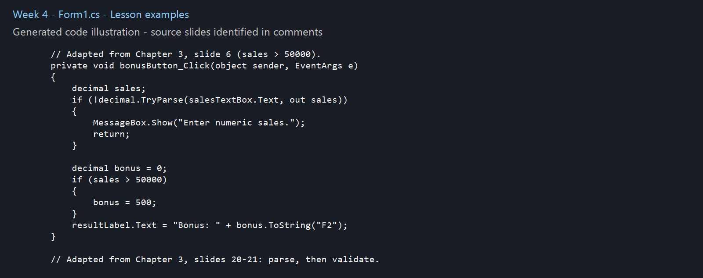
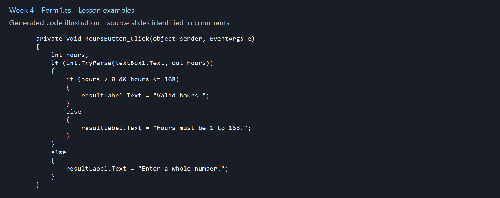

# Week 4 - Lesson Practice

## Concepts
Chapter 3: if, if-else, nested decisions, TryParse and range validation.

## Chapter summary
- `if`, `if-else` and nested decisions choose which statements execute.
- Relational operators compare values: ==, !=, <, >, <= and >=.
- Logical operators &&, || and ! combine or negate Boolean conditions. A bool variable can act as a flag.
- TryParse returns false when conversion fails. Validate both conversion and the allowed range.
- String equality compares text; use an explicit comparison such as StringComparison.OrdinalIgnoreCase when case should not matter.
- Radio buttons in the same container allow one selection. Check boxes allow independent choices. CheckedChanged responds to selection changes.
- A switch selects a case for a matching value. break ends the case, and default handles other values.
- A ListBox stores Items. SelectedIndex is -1 when nothing is selected; check it before using SelectedItem. Add, Remove, RemoveAt and Clear change the list.

## Examples from the lesson
The comments in [Form1.cs](practice/Form1.cs) identify the source chapter and slide for each example. Some short examples follow the supplied Gaddis Visual C# sixth edition slides directly; others adapt them with input controls, event handlers or error handling. Added practice code is marked. Slide numbers refer to positions in your supplied PowerPoint, whose section numbers sometimes differ from the chapter number.

## Visual Studio files
- Form1.cs contains the constructor and button Click handlers, in the style used in class.
- Form1.Designer.cs contains control creation and InitializeComponent.
- Program.cs starts the application.

Open practice/Week4.csproj in Visual Studio on Windows with the .NET desktop development workload and .NET Framework 4.8 targeting pack. Press F5. Use View Designer on Form1.cs to see the form; edit exercise logic in Form1.cs.

## Practice checks
Sales 50000 gives bonus 0.00; sales 50001 gives 500.00. Hours 1 and 168 are valid; 0 and 169 are invalid. Text such as abc displays a conversion message. The sales rule is from the lecture; input controls and messages are added practice code.

## Code images
These are generated illustrations of the included Form1.cs lesson examples, not personal Visual Studio screenshots. Repository preparation and supporting code used AI assistance.

Source: supplied Chapter 3 PowerPoint, Gaddis, Starting Out with Visual C#, sixth edition. The original slides are not redistributed here.