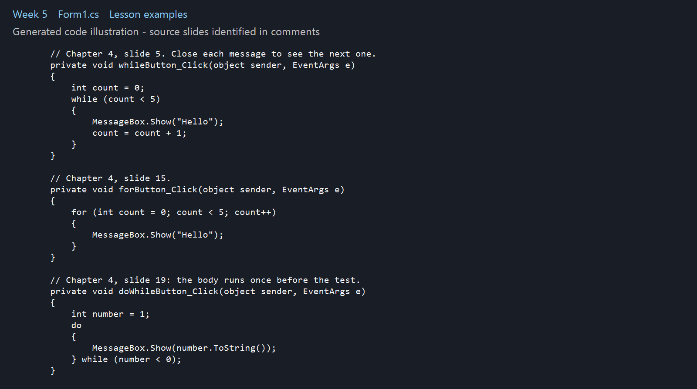
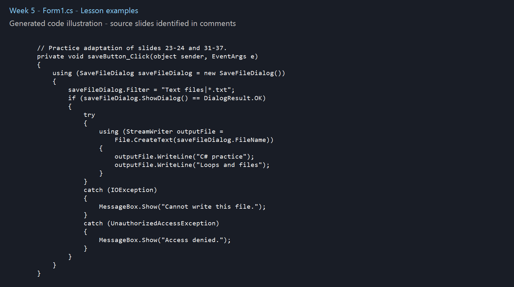

# Week 5 - Lesson Practice

## Concepts
Chapter 4: while, for, do-while, incrementing counters, writing text files and SaveFileDialog.

## Chapter summary
- while is a pretest loop and may run zero times. for groups initialization, condition and update in one statement.
- do-while checks after the body and therefore runs at least once.
- ++ increments and -- decrements. Updating the loop state prevents infinite loops.
- An accumulator stores a running total. Check loop boundaries to avoid an extra or missing iteration.
- StreamWriter writes text; StreamReader reads it. EndOfStream helps a while loop stop reading.
- File.CreateText creates or overwrites a file. File.AppendText preserves existing content and adds to the end. using closes and disposes streams even if an exception occurs.
- OpenFileDialog and SaveFileDialog choose file paths. Continue only when ShowDialog returns DialogResult.OK; FileName holds the selected path.
- Random.Next(min, max) includes min and excludes max. Next(1, 7) produces dice values 1 through 6. NextDouble produces a value from 0 inclusive to 1 exclusive.
- The form Load event runs as the form loads and can initialize displayed information.

## Examples from the lesson
The comments in [Form1.cs](practice/Form1.cs) identify the source chapter and slide for each example. Some short examples follow the supplied Gaddis Visual C# sixth edition slides directly; others adapt them with input controls, event handlers or error handling. Added practice code is marked. Slide numbers refer to positions in your supplied PowerPoint, whose section numbers sometimes differ from the chapter number.

## Visual Studio files
- Form1.cs contains the constructor and button Click handlers, in the style used in class.
- Form1.Designer.cs contains control creation and InitializeComponent.
- Program.cs starts the application.

Open practice/Week5.csproj in Visual Studio on Windows with the .NET desktop development workload and .NET Framework 4.8 targeting pack. Press F5. Use View Designer on Form1.cs to see the form; edit exercise logic in Form1.cs.

## Practice checks
While and For each display Hello five times; dismiss each message to continue. Do-while displays 1 once despite its false condition. Save writes two lines to a chosen text file. Cancel writes nothing. Saving to an existing file overwrites its contents after the dialog confirmation.

## Code images
These are generated illustrations of the included Form1.cs lesson examples, not personal Visual Studio screenshots. Repository preparation and supporting code used AI assistance.

Source: supplied Chapter 4 PowerPoint, Gaddis, Starting Out with Visual C#, sixth edition. The original slides are not redistributed here.